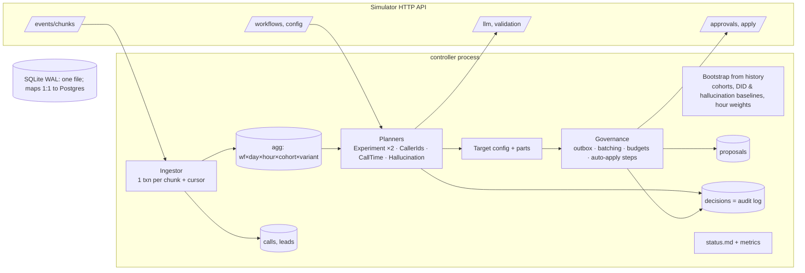
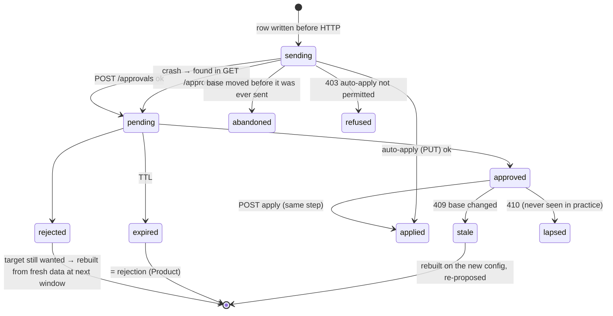

# Outcome-First Agent Loop — Submission

**Name:** Vansh Narang · **Date:** 2026-11-07 · **Hours actually spent (be honest):** [fill in honestly] · **Language / storage:** Python 3.11+ (stdlib + `httpx`) / SQLite (WAL), one file

> Built with heavy AI assistance (Claude), as the brief allows. Every rule below has a reason I can defend,
> and most of the important ones changed after I read the data. The commit history shows that.

---

## 0. TL;DR

- An always-on controller that ingests every event into one SQLite store and keeps a single shared cohort
  object per workflow. It runs a factorial welcome × voice experiment (incumbent ≥ 70%, stratified tests,
  Holm, 10% holdout after promotion, decay rollback), keeps caller IDs healthy and rotated, sets call-time
  weights from history, and handles hallucination incidents. Every change goes through governance, from
  an outbox that survives `kill -9`.
- **public_01:** +11.3% conclusion rate vs baseline, 13 changes applied (neutral: 5, beneficial: 8). **public_02:** +26.5%, 18 changes applied (beneficial: 13, neutral: 4, harmful: 1);
  the bad supervisor prompt was fixed in 210 min, the flagged caller ID was at 0% from the next day, and 5 of 200 credits were used.
- **public_03 (load):** +22.4% across 12 workflows. 840k events per simulated day, ingested at ~42k events/s;
  the loop takes ~27–35s of wall time per simulated day on 2 vCPUs (the SRE budget is 10 min).
- Crash test: 6 random SIGKILLs, including one during bootstrap. Zero events lost or double-counted, zero
  double-applies, zero lost approvals, and the result is identical to the uninterrupted run.
- **Cut:** per-person call-time (the data can't support it) and cross-tenant fairness (C15). **Partial:**
  the supervisor view is a generated page, not a UI.

## 1. Assumptions

1. **Welcome message and voice act after pickup**, so they are judged on engagement on *every* workflow,
   with pickup as their guardrail. On the pickup-primary KYC flow that reads: "never hurt pickup; improve
   what happens after it". Caller ID and call-time are pickup levers, guarded on engagement.
2. `pickup_rate_max_drop: 0.02` means **2 percentage points absolute**.
3. History (pre-D0) ran on the business default config. It tells us about hours × cohort, the caller IDs
   in use and the default prompt's hallucination rate, and nothing about other variants.
4. The hallucination detector's false-positive rate is already inside the history baseline, so thresholds
   are relative to it.
5. A supervisor edit makes those dimensions "theirs". We record it, adopt customer-facing choices as the
   new incumbent, and change them only through an approval that says it reverses their edit.
6. Tenant preferences stated in memos and stricter than policy (Kestrel: ≤ 2 requests/day, none before
   11:00) are honoured as a voluntary overlay (`controller/tenant_prefs.json`). Policy always applies on top.
7. **Expired = rejected** (Product). We never resubmit a stale body; we rebuild the target from fresh
   data on the current config.
8. The API doesn't expose approver identity. "Who approved" = the client approver for that workflow, the
   approval id and the decision time, all of which we record.
9. Prompt-catalog summaries are an *ordering prior* for which fix to validate first. Validation decides.
10. A caller ID's pickup is a usable proxy for its health. (I then observed in the data that it wears out
    with volume; see §5.)
11. One controller step = 60 simulated minutes. Approved changes have a 2h apply window, so we poll every
    step and apply on the step the approval is seen.
12. "Affected leads" = leads still in an active campaign (uploaded within the cadence span, not
    concluded) plus the next daily batch, restricted to cohorts whose dial distribution changes.

## 2. Scope decisions

| # | Capability | Built / Partial / Cut | Why | What it would take to finish |
|---|---|---|---|---|
| C1 | Ingestion at load scale | **Built** | everything depends on it; one txn per chunk + cursor | consumer process decoupled from decisions (§8) |
| C2 | Lead joins + one shared cohort object | **Built** | Product's hard requirement; experiments and detection need it | re-partition when supervisors define their own cohorts |
| C3 | Bootstrap from history | **Built** | free information: cohort sizes, hour profiles, DID baselines, hallucination baseline | — |
| C4 | Call-time optimisation | **Partial**: cohort-level only | per-person data is too thin (§3, Product) | per-person preferred hour for returning people with ≥ 5 dials, A/B'd |
| C5 | Caller-ID health | **Built** | biggest single lever on the public data (KYC +20% pickup) | re-probe flagged numbers after a cool-down |
| C6 | Welcome × voice experiments | **Built** | the core of "earn autonomy" | interaction test; per-cohort promotion |
| C7 | Promotion, decay, rollback | **Built** | a winner that decays is worse than no winner | ramped promotion (50% → 90%) |
| C8 | Hallucination response | **Built** | regulated clients: one bad script is a board conversation | exercise the LLM path more in tests |
| C9 | Governance client | **Built** | non-negotiable boundary; most failure modes live here | — |
| C10 | Impact, affected leads, dry runs | **Built** (honest, simple) | Product ranks the queue by impact | counterfactual replay for schedule changes |
| C11 | Supervisor view | **Partial** | one generated page (`state/status.md`), not a UI | serve it; per-supervisor filters |
| C12 | Audit store + "why" | **Built** | the review is run off it | — |
| C13 | Crash recovery, demonstrated | **Built** | SRE non-negotiable | — |
| C14 | Loop observability | **Partial** | metrics table + health section + page/ticket alerts | Prometheus export |
| C15 | Fair credits/attention across tenants | **Cut** | 2–4 tenants and 5/200 credits used: not the binding constraint yet | per-tenant credit budgets + approval-queue fairness |

**Principle:** build first what makes the loop *safe* (governance, crash safety, audit, incidents), then
what the data can actually support (population-level experiments, caller-ID health), and cut what the
data can't support (per-person timing). I'd rather not build a capability than ship one that produces
confident nonsense.

## 3. Stakeholders

### 01 — Nikhil Rao, VP Sales
- **Accepted:** speed where it's safe. Exploration goes live on D0, and auto-apply is used wherever policy
  permits (caller ID, schedule; Kestrel's welcome/voice for protective moves). The status page shows one
  lift figure *per KPI* per client.
- **Declined:** a single blended score (it breaks constraint 3 and Product's definitions). "Winning by
  lunch, live by evening": a half-day of data is ~100 connects per arm, and at that size my rule would
  promote noise. The current rule promotes a real +12% lift by about day 4, with a 2.5% false-winner rate
  (§5). Also declined: rolling the "persuasive" prompt out everywhere.
- **Wrong against policy:** *"Kestrel has auto-apply for everything"*: `ks_cancel` allows schedule,
  caller ID, welcome and voice, **not prompts**, and caps each change at a TV shift of **0.2**. *"Northwind
  is fine with auto-apply on KYC"*: `nw_kyc` has `auto_apply.enabled: false`, and Northwind's compliance
  head requires named human approval for anything customer-facing. *"Persuasive tested well elsewhere"*:
  P4 isn't even an option on `nw_kyc`, prompt changes need validation evidence per workflow, and Product
  rules that a winner only updates its own workflow.
- **Reply:** "Nikhil, you'll have a number per client: pickup and engagement lift vs baseline, shown
  separately because Product and our clients define them separately. On public scenarios that's +10% to +27%
  more leads concluded. I can't push winners straight through: Kestrel's auto-apply excludes scripts and
  caps each step at 20%, and Northwind KYC has no auto-apply at all. Their compliance head wants a named
  human on every customer-facing change. The safe speed is about four days to a proven winner. 'Persuasive'
  doesn't roll out anywhere without validation on that client's own workflow."

### 02 — Meera Iyer, Head of Compliance, Northwind
- **Accepted, all of it.** Customer-facing changes on Northwind (welcome, voice, script) only go through
  approval; Northwind's policy already says so, and I don't auto-apply customer-facing changes on any
  tenant except protective rollbacks where policy allows. Script changes carry a `validation_run_id`
  (the simulator enforces this too). "Why did this customer hear this" is one command
  (`python -m controller.why person <id>`, §10), not 24 hours. "Slow and right": α = 0.01, a 10%
  holdout after every promotion, and a check that blocks a promotion that hurts any cohort.
  Non-urgent requests only go out inside 10:00–19:00 (KYC 10:00–18:00) and never in the last 2 hours.
- **Pushback:** two honest caveats. Exploration means a minority of customers (≤ 30%) hear a test variant;
  that is what she approves when she approves the test. And a *safety* request (hallucination fix) is sent
  the moment it's ready, even at night, because queueing it costs nothing and sending it late costs MTTR.
- **Wrong:** nothing. Her hours match the policy. One nuance: on **KYC**, policy disables auto-apply
  completely, so even caller-ID and timing changes go through approval there. That's stricter than her
  "operational settings are covered" suggests.
- **Reply:** "Meera, every change to what a Northwind customer hears goes to your approvers with its
  evidence attached: the diff, affected leads, a dry run, and for scripts a validation run that must pass
  ≥ 97%. For any customer we can show, from our own records, each call's opening, voice, script and caller
  ID, plus the change, approval and data that put it live. That takes minutes. Requests go out only inside
  your approvers' hours, except an urgent safety fix, which waits in your queue. On KYC even timing and
  caller-ID changes come to you, because that policy has no auto-apply. Weekly summary: yes, generated from the same log."

### 03 — Kabir Menon, Platform & SRE
- **Accepted:** a kill/restart test (6 SIGKILLs at random moments, invariants checked against the
  simulator's records, §9). Idempotency everywhere: an outbox with DB-derived proposal ids, reconciliation
  before resend, one transaction per chunk. Alerts split into PAGE and TICKET, each naming what to look at.
  Loop health is visible without logs (`metrics` table + status page). And the load numbers (§8).
- **Pushback:** this submission uses **SQLite**, not their Postgres, so the reviewer needs no
  infrastructure. It's an embedded file, there's no daemon to operate at 2 a.m., and the schema maps 1:1
  onto Postgres tables. In production it goes into the existing Postgres. No Redis is needed.
- **Wrong:** nothing. "The clock doesn't wait" is the real gap: my loop ingests and decides synchronously
  per step. §8 says what that costs at 10× and how I'd split it.
- **Reply:** "Kabir, the kill test is in `scripts/crash_test.py`: 6 random SIGKILLs (one mid-bootstrap),
  then checks against the simulator's own records. Events: 104,000 = 104,000. Duplicate applies: 0. Lost
  approvals: 0. Every outgoing change is written before it's sent and reconciled before any resend. One
  load day takes ~30s of loop time on 2 vCPUs, against your 10 min. At 10× the history bootstrap and the
  single SQLite writer break first, so production uses your Postgres, partitioned by workflow, with no new
  stateful infra. Pages are only for things a human must do now."

### 04 — Anita Desai, Ops Supervisor, Kestrel
- **Accepted:** I never undo her changes behind her back. A script she ships is only reverted through
  an approval request that says, in its summary, *"this reverses a supervisor's script change"*, and
  only on hallucination evidence. A welcome or voice she sets is adopted as the new baseline and our test
  pauses. **≤ 2 requests a day, none before 11:00, everything batched into one** (voluntary; policy
  allows 4 from 10:00). One screen: `state/status.md`, with what's tested, what's winning, what we need
  from her and what changed today. On her "word-for-word script" story: near-verbatim prompts are ranked
  last as fix candidates, because validation can't see engagement, and a fix prefers a script with a
  proven field record.
- **Pushback:** "Tell me *before* anything changes on a running campaign." Kestrel's policy lets us
  auto-apply caller ID, timing and (within 20%) welcome/voice. I use that for *protective* moves (stop
  dialling a flagged number, drop a variant that's losing) and daily caller-ID rotation. Those show on
  her page within the hour, **not before**: waiting for a heads-up would keep customers on a bad number.
  Everything planned comes to her as a request first.
- **Wrong:** policy allows 4 requests/day, not 2; I honour 2 anyway. And her own script edit in
  public_02 (P2: "payment-urgency language and benefit claims") failed validation (0.935) and pushed
  hallucination flags to 5%. That's the one case where we asked her to undo something.
- **Reply:** "Anita, at most two requests a day, none before 11:00, everything batched. I won't undo your
  edits behind your back. If you change a voice or opening, that becomes the baseline. The only time I'll
  ask to undo a script change is if hallucinations spike, and the request will say so plainly, with the
  numbers. Protective fixes (stopping a spam-flagged number, dropping a losing variant) happen right away
  and show on your page within the hour, because waiting would hurt customers. Your page shows what's
  tested, what's winning, what I need from you and what changed today."

### 05 — Tara Kulkarni, Head of Product
- **Accepted:** separate KPIs everywhere. **One cohort object**: the `cohorts` table, whose ids are the
  config's cohort ids, the analysis keys and the status-page rows. Minimum cohort size is answered in §5:
  6% of leads, about 66 a day on renewal, which only detects ≥ 30% effects inside a cohort. That's why
  winners are workflow-level and cohorts are used to *block* harm. Every proposal carries an impact score
  with a stated meaning (§6), a diff, affected leads and a dry run. Expired = rejected and rebuilt fresh.
  "Only what happened counts": the analysis compares arms only within strata where both actually ran, so
  an arm that never got approval has no rows. Winners update their own workflow only.
- **Pushback:** three P0s; I built **caller-ID health** (it was the largest lever in the data) and a
  **minimal supervisor view**, and **cut per-person call-time**. 60–80% of leads are new each campaign, and a
  returning person has at most a few past dials, so a per-person "best hour" is noise. The ×6 / ×0.25
  multiplier makes a wrong guess expensive. I shipped cohort-level call-time instead, with a guardrail.
- **Wrong:** "per-person call-time is the headline" assumes per-person data that doesn't exist at this
  scale.
- **Reply:** "Tara, I held all your definitions: separate KPIs, one cohort object with one id everywhere,
  expired = rejected and rebuilt, no learning from arms that never ran. Minimum cohort size: 6% of leads,
  with the speed-vs-false-winner maths in the doc (2.5% false winners, 90% power on a +12% lift). Of your
  three P0s, caller-ID health and the supervisor view are in. Per-person call-time is out: most people are
  new each campaign and returning ones have a handful of dials, so a per-person hour would be confident
  noise. Cohort-level call-time ships instead, behind a guardrail."

### 06 — Aryamann, CTO
- **Accepted:** explainability over size of lift (every change answerable from our store, §10). "Hurts a
  cohort is worse than nothing": the cohort-harm check at promotion, protective drops, and adopting
  supervisor choices instead of fighting them. "Best compute is no compute": **5 of 200 credits** on
  public_02. Validation is spent only where it changes a decision, and the fix tried first is the
  field-proven prompt, not an LLM call. Scale numbers and what breaks first are in §8; scope choices are
  in §2; the on-call runbook is `docs/CONTROLLER.md`.
- **Pushback:** none, but one honest gap. My biggest remaining harm is promoting a winner that is
  *already* fading (public_02 W3). §13 has what I'd do about it.
- **Wrong (in the other memos):** Kestrel auto-apply "for everything", Northwind KYC auto-apply, the
  persuasive prompt being available everywhere, Kestrel's "2 requests" being the policy, per-person data
  being sufficient. I also found one assumption of my own that was wrong: comparing a caller ID only
  against the other numbers. A fresh number makes a normal one look broken (§5).
- **Reply:** "Aryamann, I chose safety and explainability first: governance, crash safety, audit and
  incidents; then the levers the data supports. Results on public scenarios: +10% to +27% conclusion rate,
  zero harmful changes on public_01 and public_03 (55 applied), one on public_02 (a winner that was already fading;
  the holdout caught it). 5 credits used in the incident scenario. Cut: per-person timing and cross-tenant
  fairness. The audit CLI answers 'why did X change at T' live. I'm happy to be tested on any decision."

## 4. Architecture



Loop per step (60 sim-min): `catch_up` (ingest every chunk after the cursor) → `reconcile` (poll open
approvals, apply approved, settle `sending` rows) → for each workflow: refresh config, update
experiments / caller IDs / call-time / incident state, build a target config, let governance decide
auto-apply vs approval vs wait → write metrics → advance.

**All state lives in SQLite**: aggregates, leads, calls, cohorts, config versions, proposals (outbox),
decisions (audit), learned state (JSON per workflow), validation runs, metrics. **On restart**: the store
is checked against the world (scenario name, end minute, our clock ≤ theirs); missed chunks are ingested
by cursor, `sending` proposals are looked up in the simulator before any resend, the lead→cohort join is
rebuilt from `leads`, and the loop continues at the simulator's current minute.

## 5. The learning loop

**Cohorts.** One partition per workflow, built once from history and frozen: `lang × X`. X is the feature
whose values have the most different hour-of-day pickup profiles in history (χ²/df on the value × hour
table; it came out as `age_band` on every public workflow). Cells under **6% of leads** merge into a
per-language remainder, or into `default`. Result: 7–9 disjoint cohorts covering 94–100% of leads.
Why 6%: on renewal (~955 connects/day) a 6% cohort gets ~57 connects/day, so a challenger at 15% sees
~9/day in it. Sample sizes at α = 0.01 and power 0.8 (base 0.55): **+30% needs 183 per arm, +12% needs
1,141, +5% needs 6,570**. Inside a cohort we can only ever detect huge effects. So **winners are chosen
at workflow level**, and cohorts are used to *veto*: a promotion is blocked for any cohort where the
winner is significantly worse (Holm across cohorts, p < 0.05, ≥ 5% worse). Smaller cohorts would
fragment traffic for no decision value.

**Experiment design.** The simulator samples welcome, voice and caller ID independently per dial, so
welcome × voice is a **factorial design for free**: both run at once on the same traffic. The incumbent
keeps ≥ 70%, and each challenger gets ≤ 15% (a bad arm can cost at most 15% of calls). Analysis is a
**Cochran–Mantel–Haenszel-style stratified difference** over strata (day, hour, cohort, prompt,
*other* dimension), using only strata where both arms ran. That makes the estimate robust to time
trends, mid-experiment allocation changes, supervisor prompt edits and the other factor. It also
enforces "only what actually happened counts". I don't test the welcome × voice interaction explicitly
(§13).

**Deciding a winner.** One-sided z on the stratified difference; **Holm across challengers**; one
"look" per day (just before the approval window). Promote if Holm-p < **0.01**, n ≥ **400** connects per
arm, lift ≥ **3%**, the guardrail is non-inferior (90% lower bound of the pickup difference > −2pp), no
cohort is significantly hurt, and the last-48h edge is at least half the overall edge (not fading). Drop an
arm early if it's worse with p < 0.01 since start, or p < 0.005 and ≥ 8% worse over the last 48h. Futility
at 3,000 connects per arm. **Measured by Monte Carlo of this exact rule** (`scripts/false_winner_sim.py`,
8 daily looks, 3 null challengers at realistic volumes): **false-winner rate 2.5%**; power **90% for a +12%
lift and 49% for +8%**. At α = 0.05 the false-winner rate would be 11% for +6pp of power; not worth it for
regulated clients.

**Decay and rollback.** After promotion the winner runs at 90% and the old incumbent stays as a **10%
holdout**. Every step: winner vs holdout over the last 36h; roll back if the holdout is better with
p < 0.02, ≥ 3% worse, holdout n ≥ 120. On public_02 the decaying W3 was rolled back ~2 days after it went
live (detection, then approval latency: rollback of a customer-facing dim needs approval on Northwind).

**Call time.** From history: cohort × hour pickup, shrunk to the cohort mean (k = 150 dials), weight =
(rate in hour ÷ cohort mean)², clipped to [0.25, 4]. Every in-window hour stays > 0, so no capacity is
idle. Cohorts with a flat profile get no table. A dry run on history models +0.5–0.7pp pickup (optimistic:
it ignores cadence). It's verified after 24h live: pickup after vs the 3 days before, *within the same
caller ID* (a first version compared against the 14-day history mean and falsely reverted on KYC,
because the number itself was wearing out). Revert if worse by > 2pp at z < −3. **Per-person timing: cut**
(§3, Product).

**Caller ID.** The most useful thing the data taught me: **a caller ID's pickup falls the more volume
it carries, and a fresh number starts high** (Kestrel D3 went 30% → 18% at 100% share; KYC D2 34% → 28%).
My first rule compared each number against the others and flagged a perfectly normal D1 next to a fresh
D3. The rule now:
- **Flag** only when a number dropped against *its own* previous 3 days (≥ 25%, n ≥ 150 in 6h, p < 1e-4)
  *and* is below the other live numbers. It then goes to 0% (auto-apply in steps of max_shift where
  allowed, otherwise an urgent approval).
- **Probe** unused numbers at 10% before trusting them; promote after 300 dials unless clearly bad.
- **Rotate**: active numbers share traffic in proportion to recent pickup², with a 10% floor. Rebalance at
  most daily and only if it moves > 0.15 TV, unless the expected gain is ≥ 5%.

This turned out to be the largest lever on the pickup-primary KYC flows (+20% to +28% pickup across the three scenarios).

**Guardrail.** Every promotion tests the guardrail KPI with a non-inferiority bound (above). Schedule
changes have their own guardrail check. Caller-ID moves are evaluated on pickup directly. A change
that helps primary but fails the guardrail is logged as `promotion_blocked` and never proposed.

## 6. Governance



**Batching and timing.** Each step builds *one* target config per workflow from all planners, so a request
bundles everything (public_02 D0: cohorts + welcome + voice + caller ID + schedule in one request).
Non-urgent requests go out only within `[approver start (or tenant preference), end − 2h)`, at least 4h
apart. One request a day is always held in **reserve** for protective changes. Protective changes
(rollback, arm drop, flagged DID, hallucination fix, schedule revert) go out immediately, queued if
outside hours. If one is pending, a protective change is sent as a superset. Result on public_02: peak
**2 requests per 24h** on any workflow (cap 2–4), **0 lapsed, 0 apply conflicts, 0 fatigue
rejections**; the only rejections were the approver's random judgement calls.

**Auto-apply, used and voluntarily not.** Used for caller ID and schedule wherever policy allows, and for
*protective* welcome/voice moves on Kestrel. **Not used** for planned customer-facing changes even where
Kestrel's policy would allow it, because Anita asked to know before, and Northwind's compliance standard
is the stricter industry norm. **Never** on a dimension a supervisor set in the last 24h. Each auto-apply
moves at most `max_shift` (TV) per step and one step per hour, rather than chaining steps in one tick.

**Impact, affected leads, dry run.** `impact_score` = expected extra concluded leads per day ÷ (5% of the
daily batch), clipped to [0,1]; safety fixes are floored at 0.9. The expected gain comes from the dry
run: for welcome/voice, observed per-arm engagement since the experiment started is replayed against the
old and new allocations (arms with no data are assumed equal to the incumbent and listed as such). For
caller ID, the last-24h pickup per number is replayed the same way. For schedule, the history model at a
50% discount. So **exploration scores low** (the D0 renewal bundle scored 0.22, almost all of it from the
call-time model) and a proven promotion scores high (W3: 1.0, clipped). That was the honest number at the
time, and it turned out wrong because W3 was fading (§13). `affected_leads` is defined in assumption 12 and
shown with its components in the dry run.

**Supervisor edits mid-experiment.** Recorded as a decision and marked as supervisor-owned for 24h.
Experiment analysis keeps working because it's stratified by prompt and only compares arms that ran. A
supervisor's welcome/voice choice becomes the **new incumbent** and exploration on that dimension stops.
It's challenged only if an alternative beats it on the record, and that proposal says it reverses their
choice. (I learned this from an early run, where re-asserting our experiment 24h after a supervisor's
voice edit was judged harmful.)

## 7. Incidents

**Hallucination detection.** Rate per prompt over the last 4h of connected calls vs the history baseline
(~1.2–1.5%). Fire when n ≥ 200, rate > max(2.5× baseline, baseline + 2pp) and a Poisson tail gives
**p < 1e-5**. Calibration: across a whole no-incident run (public_01, 3 workflows, hourly checks over
8 days) the most extreme window was **p = 7e-4**. My first threshold (1e-3) fired a false incident there.
1e-5 leaves ~70× margin, and a real bad prompt (5–7%) still clears it within 2–3h. **Suspect path**: when
a supervisor ships a prompt with no field record, one 200-conversation validation (2 credits) runs. If it
fails, that's independent evidence, and the field bar drops to p < 1e-3 at n ≥ 100.

**Picking a fix.** First the last prompt that ran clean in the field (its engagement is known too): one
validation of n = 300 (3 credits). Only if none passes do we ask the LLM (3 credits) and validate its
suggestions in catalog-risk order (grounded first, near-verbatim last). The LLM proposes; the pass rate
against the policy threshold decides. Cap: 20 credits per incident, 15 held in reserve.

**Verification.** After the fix is live: ≥ 200 connects with the Wilson upper bound under threshold (or
n ≥ 400 and rate under threshold) → resolved. Otherwise the fix is marked failed and the next candidate is tried.

**public_02 timeline (ks_cancel, from `why log`):**
- D2 10:00 caller ID D2 degrades (grader). **D2 12:00** flagged: 15.0% in 6h vs 24.4% its own previous
  3 days, −46% vs other numbers → auto-apply steps of 0.2 TV (Kestrel max_shift); D2 carried 11% of that day's dials, and 0% from D3 on.
- **D3 11:30** supervisor ships P2 ("payment-urgency language and benefit claims").
- **D3 12:00** suspect: P2 validation pass rate 0.935 (needs 0.97). 2 credits.
- **D3 13:00** detected (on the suspect bar): 10/157 = 6.4% flagged in 4h vs 1.5% baseline. Fix chosen: P1
  (field-proven), validation 0.990 on n = 300. 3 credits. Urgent approval sent, summary says it reverses the supervisor's change.
- **D3 15:00** approved and applied: **MTTR 210 min** from the edit (grader). **D3 18:00** verified: 0/284 flagged since.
- nw_renewal **D5 15:00**: a supervisor sets voice V2 = 100% mid-experiment → **D5 16:00** adopted as baseline,
  voice test paused, no counter-proposal.

## 8. Scale

Measured on `public_03_load` (12 workflows, 5 days), on **2 vCPUs** (the brief's box has 4), with the
simulator on the same machine:

| metric | value |
|---|---|
| live events / simulated day | 840,000 (peak 192k in one hour) |
| ingest throughput | **~42,000 events/s** (single thread, JSON parse + SQLite upserts) |
| ingest per simulated day | ~20 s |
| decisions per simulated day (12 workflows) | 4 s (D0) → 12 s (D2–D4), since queries scan the experiment window |
| controller loop per simulated day | **27–35 s** (SRE target: < 10 min) |
| decision freshness | 0 unread chunks at every decision; staleness = one step (60 sim-min) |
| bootstrap | 5.5M history events in 116 s |
| peak RSS | 1.1 GB (high-water during bootstrap) |
| store size | 1.4 GB after 5 days (the per-call compliance table is ~85% of it) |
| end-to-end wall time | 342 s for 5 days including bootstrap |

**What breaks first at 10×** (8.4M events/day, ~2M at peak hour, 120 workflows):
1. **Bootstrap**: ~55M history events ≈ 18 min single-threaded. Fix: per-workflow parallel bootstrap and
   cell-level history aggregated at the source.
2. **The single SQLite writer and the `calls` table** (~14 GB per 5 days). Fix: Postgres partitioned by
   day and workflow, 90-day retention on `calls`, aggregates kept separately.
3. **Decision queries** grow with the experiment window (11 s/day at D4 for 12 workflows → ~2 min at 120,
   still inside budget but growing). Fix: incremental per-arm/stratum counters updated at ingest instead
   of re-scanning `agg`.
4. Ingest itself (~3 min/day at 10× on one core) is fine.

**Partitioning:** workflows are independent apart from the credit pool and tenant preferences. So:
one ingest consumer per partition of workflows (hash by tenant, so a tenant's approval budget and prefs
stay in one place), one decision worker per partition, a shared Postgres, and a small credit-allocation
service (C15) once incidents can collide across tenants.

## 9. Reliability

**Method.** `scripts/crash_test.py` runs public_02, sends **SIGKILL** to the controller at 6 random
moments (2–7s apart, one during the history bootstrap), restarts it each time, lets it finish, then checks
invariants **against the simulator's records**, not ours. Report: `reports/crash_test.md`.

| invariant | result |
|---|---|
| scenario finished | PASS |
| no event lost or double-counted | PASS: sim call events 104,000 = our aggregates 104,000 = our call rows 104,000 |
| no double-apply | PASS: every proposal_id appears at most once in config history |
| no lost approval | PASS: nothing approved-but-unapplied, nothing lapsed |
| every applied change auditable | PASS |

The graded outcome of the killed run is **identical** to the uninterrupted run (`reports/crash_grade.md`).
**State lost:** none that matters. A kill mid-chunk re-reads that chunk; a kill between "decide" and
"send" leaves a `sending` row that is reconciled. At worst, a decision row (audit text) is written twice
when a step re-runs at the same minute after a kill.

**Idempotency keys.** Proposal ids are `wf-channel-minute-seq`, with seq from the DB, written before
the call. `409 duplicate_proposal_id` means "it went through", so we reconcile and never resend. The
chunk cursor commits in the same transaction as the chunk's data. `apply` of an already-applied approval
returns `409 not_approved {status: applied}`, which is recorded as applied.

**4xx/5xx.** 5xx and transport errors retry with backoff (8×, up to 10s). `advance` is never blindly
retried: the clock is checked first, so a lost response can't advance the world twice. 4xx raise typed
errors: `stale_base_version` → rebuild on the new config; `410` → lapsed; `403 auto_apply_not_permitted`
→ logged and left to the approval path; `402` → the credit reserve prevents it; anything else → `invalid`
+ a ticket alert.

## 10. Audit & observability

```text
$ python -m controller.why --db state/public_02/controller.db change ks_cancel "D3 15:00"
# ks_cancel at D3 15:00
v8 live since D3 15:00, set by controller_approved, dims ['prompt_version']
  proposal ks_cancel-appr-005100-0013 via approval, sent D3 13:00: Switch script P2 → P1: hallucination flags 6.4% vs 1.5% normal (this reverses a supervisor's script change)
  approved by the client approver: apr_00006 (status applied)
  impact_score=0.9 affected_leads=4538
  D3 13:00 [propose] [urgent] Switch script P2 → P1: hallucination flags 6.4% vs 1.5% normal (this reverses a supervisor's script change)
  D3 15:00 [applied] Applied apr_00006 → v8 (prompt_version)
  evidence trail:
    D3 12:00 [halluc_suspect] Supervisor prompt P2 failed validation (0.935); watching it closely
    D3 13:00 [halluc_detected] Hallucination flags on P2: 10/157 = 6.4% in the last 4h vs baseline 1.5% — opening incident
    D3 13:00 [halluc_fix_chosen] Fix for P2: switch to P1 (field-proven); validation pass rate 0.990 on n=300 (needs ≥ 0.97)
what happened next (48h):
  D3 18:00 [halluc_verified] Fix P1 verified: 0/284 = 0.0% flagged since going live (threshold 3.7%); time to fix 5h
```

And the compliance question, "why did this customer hear what they heard":

```text
$ python -m controller.why --db state/public_02/controller.db person ks_cancel:p0010349
# calls to ks_cancel:p0010349
D-5 12:14 ks_cancel:l00014366 cohort=default heard welcome=W1 voice=V1 script=P1 from D1 → no answer (config v1)
    v1 live since —, set by business_default, dims []
D-3 09:46 ks_cancel:l00014366 cohort=default heard welcome=W1 voice=V1 script=P1 from D1 → no answer (config v1)
D-3 12:44 ks_cancel:l00014366 cohort=default heard welcome=W1 voice=V1 script=P1 from D1 → connected, engaged (config v1)
D4 16:54 ks_cancel:l00025829 cohort=kn_age31_45 heard welcome=W1 voice=V1 script=P1 from D3 → no answer (config v8)
    v8 live since D3 15:00, set by controller_approved, dims ['prompt_version']
      proposal ks_cancel-appr-005100-0013 via approval, sent D3 13:00: Switch script P2 → P1: hallucination flags 6.4% vs 1.5% normal (this reverses a supervisor's script change)
      approved by the client approver: apr_00006 (status applied)
      impact_score=0.9 affected_leads=4538
      D3 13:00 [propose] [urgent] Switch script P2 → P1: hallucination flags 6.4% vs 1.5% normal (this reverses a supervisor's script change)
      D3 15:00 [applied] Applied apr_00006 → v8 (prompt_version)
```

**Page on:**
- a hallucination incident with no validated fix;
- a protective change blocked by the approval budget (call the client);
- credits < 30.

**Ticket, don't page:** the API rejecting a proposal as invalid (a bug, not an emergency).

**Never page:**
- judgement-call rejections and expiries (re-proposed automatically);
- arm drops and rollbacks (they *are* the fix);
- caller-ID flags (auto-handled where policy allows; otherwise an urgent approval).

Loop health (ingest rate, decision ms, freshness, credits, open proposals, RSS) is in the `metrics`
table and the status page.

## 11. Results

**public_01** (`reports/public_01.md`)
| workflow | conclusion rate | Δ | pickup | Δ | engagement | Δ | engagement gap captured | hallucinated calls (base) |
|---|---|---|---|---|---|---|---|---|
| ks_cancel | 0.375 | +9.9% | 0.261 | +8.7% | 0.507 | +1.3% | 4% | 66 (52) |
| nw_kyc | 0.456 | +21.0% | 0.290 | +19.9% | 0.606 | -0.9% | 10% | 29 (21) |
| nw_renewal | 0.451 | +7.2% | 0.280 | +7.0% | 0.549 | +0.3% | 10% | 46 (39) |
| ALL | 0.418 | +11.3% | 0.273 | +10.2% | 0.542 | +0.7% | 7% | 141 (112) |

**public_02** (`reports/public_02.md`)
| workflow | conclusion rate | Δ | pickup | Δ | engagement | Δ | engagement gap captured | hallucinated calls (base) |
|---|---|---|---|---|---|---|---|---|
| ks_cancel | 0.364 | +49.4% | 0.247 | +35.2% | 0.504 | +6.7% | 35% | 88 (310) |
| nw_kyc | 0.479 | +24.7% | 0.299 | +20.7% | 0.604 | +0.8% | -2% | 41 (38) |
| nw_renewal | 0.473 | +9.9% | 0.293 | +11.3% | 0.537 | -2.0% | -2% | 64 (58) |
| ALL | 0.425 | +26.5% | 0.273 | +22.4% | 0.537 | +1.3% | 19% | 193 (406) |

**public_03 load** (`reports/public_03.md`): +22.4% conclusion rate overall, 55 changes applied (neutral: 16, beneficial: 39).

**Interpretation.**
- **Where we helped:** pickup, mostly through caller-ID rotation and health (KYC +20% to +28%), and
  engagement through promoted welcome/voice winners (Kestrel voice/welcome, KYC). The Kestrel bad-prompt
  incident is the largest single win on public_02: 310 hallucinated calls under baseline vs 88
  with us.
- **Where we were harmful:** one change on public_02. We promoted W3 on nw_renewal on D4 with +14% on
  4 days of data, but it was already fading. Its daily edge read +20%, +16%, +14%, +4%, each ±10pp, so a
  trend rule tuned to catch that would be overfitting one public case. The holdout caught it and we rolled
  back. Exploration itself can also be judged harmful at apply time when a challenger is bad. That happened
  in an early iteration and is why each arm is capped at 15%.
- **Engagement gap captured is low (8–28%).** The oracle is per-cohort/per-person; we only promote
  workflow-level winners. That's the price of the 2.5% false-winner rate at these volumes.
- **Run-to-run variance:** the simulated approver's decision is seeded by proposal id, so any code change
  reshuffles which requests get the ~10% judgement-call rejection. public_01 ranged +10% to +13% across
  my last versions. I report the final run, not the best one.

## 12. Trade-offs & rejected alternatives

| Option | Why considered | Why rejected / what instead |
|---|---|---|
| Thompson-sampling bandit for allocation | more conversions while learning | every allocation change is an approval on Northwind (2–3/day). A bandit that can't move is just a slower A/B; deterministic tests are also what the brief requires |
| α = 0.05 | +6–20pp power | false winners 11% vs 2.5% (simulated); regulated clients prefer slow and right |
| Per-cohort promotion | captures heterogeneity (the oracle gap) | cohort-day volumes of 10–30 connects; per-cohort z-scores didn't replicate across scenarios. Cohorts veto instead |
| Even split exploration (25% each) | fastest learning | one bad arm costs 25% of calls and gets judged harmful; capped at 15% per arm |
| Caller ID: flag vs the other numbers | simple, standard | misfires next to a fresh number (observed); own-baseline + vs-others instead |
| All DIDs equal | simple | numbers wear out with volume; rotate by recent pickup² |
| LLM picks the prompt fix | fewer steps | not allowed to decide; also cheaper to validate the field-proven prompt first (3 credits vs 6–9) |
| Postgres + Redis | prod parity | the reviewer would need infra; SQLite file with a 1:1 schema |
| Async ingest worker + decision worker | production shape | the simulator's clock waits for us; synchronous keeps crash semantics simple. Described in §8 |
| Store only aggregates | 6× smaller store | compliance needs per-customer "what did they hear" |

## 13. Known weaknesses

1. **Promoting a fading winner** (public_02 W3): the holdout catches it in about 2 days, but on Northwind the
   rollback then waits for an approver. I'd ramp promotions (50% → 90% after 24h of confirmation): a
   50% holdout detects decay ~5× faster, at the cost of one more request.
2. **Cohort-specific decay during exploration** (public_01 W3 stayed at ~15% for the whole run): at
   10–30 connects per cohort-day it isn't detectable. No fix at this volume except a smaller exploration share.
3. **Low engagement-gap capture**: workflow-level winners only.
4. **Call-time weights have no randomised control**; the benefit is modelled (+0.5–0.7pp), not proven. Only
   the guardrail is real. I'd randomise by person via `lead_preferred_hour` to measure it.
5. **No welcome × voice interaction test**; main effects are averaged over the other factor via strata.
6. **Flagged caller IDs are never re-probed**; a number that recovers stays unused.
7. **The LLM-fix path is less exercised**: in the final public runs a field-proven prompt always passed first.
8. **Supervisor ownership is a 24h heuristic**; a supervisor who edits daily effectively freezes a dimension.
9. Bootstrap memory and time scale linearly with history (§8).
10. **We adopted a supervisor choice our data says is worse.** On public_02, renewal's supervisor set voice V2 = 100%;
    our test had dropped V2 two days earlier (−18%, p = 0.008, n = 168). The Holm-adjusted evidence was too weak to
    propose overriding them, so we said nothing. The status page should at least show them the number.
11. **Rollback impact scores understate urgency.** The dry run replays per-arm rates over the whole experiment,
    so the W3 rollback scored 0.14 (W3 still looked good on the full record). It should replay the decay
    window that triggered the rollback. It's a one-line change; I found it after the final runs and didn't want
    reports and code to disagree.
12. `affected_leads` counts leads in affected cohorts, not leads whose *experience* changes (a 10% shift
    reports the whole cohort). It's conservative, and labelled as such in the dry run.

## 14. If this went to production at Formi next month

1. **Week 1, shadow mode** on 3–5 real workflows: ingest, decide, write proposals to our store, send
   nothing. Compare our would-be changes with what humans did. Calibrate the hallucination threshold on
   real detector noise.
2. Move the store to the existing **Postgres** (same schema), split ingest into a consumer, add retention
   on `calls`, and export metrics to the existing monitoring.
3. **Caller-ID health first, live** (auto-apply where contracts allow): it's operational, explainable,
   and the biggest measured lever. Weekly summary to Northwind as promised.
4. Supervisor page served from the store; walk Anita and Meera through it; add their preferences to config.
5. **Week 2, experiments live** on one tenant with an approver who has opted in, using ramped promotion.
   The review of the first 10 decisions is done from `why`.
6. Hallucination response live, with an on-call drill: ship a known-bad prompt to a test workflow and
   time detect → approve → verify.
7. Only then: per-cohort promotion research and the credit/attention fairness service (C15).
